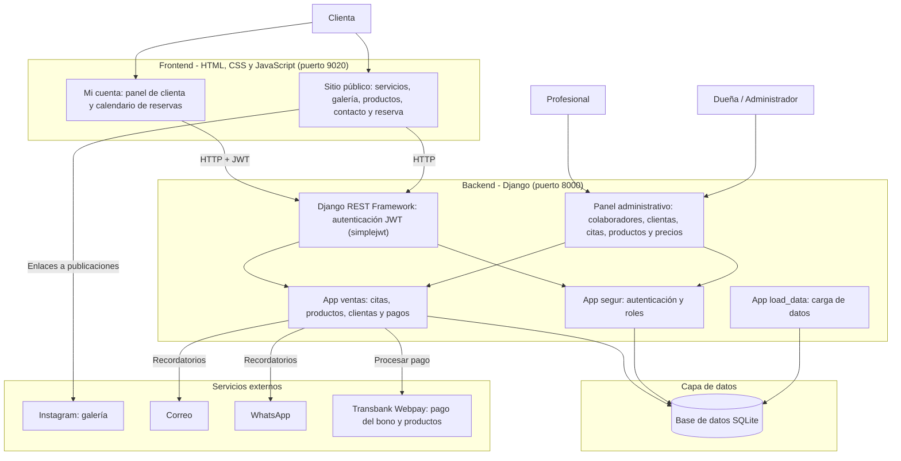

# Nicolette Studio Fantasy

Plataforma web de gestión, ventas y atención de clientas para la peluquería Nicolette Studio Fantasy.

## Descripción

**Qué hace:** es una plataforma web que da a la peluquería presencia en internet y un sistema propio para administrar el negocio. Va más allá de la agenda: reúne la oferta de servicios, la venta de productos, el registro de las clientas y su historial de atenciones, y la comunicación con ellas.

- **Para la dueña:** un panel administrativo donde puede agendar y cancelar citas, bloquear días completos en los que no quiere trabajar (incluso con anticipación), vender productos y ofrecer sus servicios por internet y por Instagram. Además, lleva el historial de servicios de cada clienta y sabe cuáles son menores de edad, para quienes existe el Rincón Kids, adolescentes y mucho más.
- **Para las clientas:** pueden crear una cuenta, iniciar sesión, ver los servicios de la peluquería, revisar su perfil y conocer los beneficios por ser clientas frecuentes. También agendan sus horas por sí mismas y, para confirmar una cita, deben pagar un abono por el servicio, que se cobra de inmediato mediante WebPay.
- **Avisos:** cada vez que una clienta agenda o cancela, se notifica por correo a la dueña y en el panel administrativo.

**A quién va dirigido:**

- La dueña de la peluquería, que administra el negocio.
- Los trabajadores del local, que atienden a las clientas.
- Las clientas, que consultan servicios y reservan sus horas.

**Qué problema resuelve:** la dueña no tenía página web y llevaba toda su agenda en un cuaderno o en una planilla de Excel. Esto provocaba que las horas se duplicaran o se perdieran, y que las clientas tuvieran que buscarla por WhatsApp para agendar. Tampoco quedaba registro de qué servicio se realizó, cuánto se cobró ni qué profesional atendió, lo que generaba pérdida de clientela. Además, no existía ningún mecanismo de pago previo, por lo que una clienta podía reservar y no asistir. La plataforma ordena la agenda, asegura cada reserva con un abono, deja un registro de cada atención y de cada clienta, y le da a la dueña un canal propio para ofrecer sus servicios y vender sus productos.

## Funcionalidades principales

- Catálogo de servicios (59 servicios en categorías como colorimetría, tratamientos, manicure, pedicure, podología, corte de cabello, cejas, pestañas, uñas y depilación).
- Registro e inicio de sesión de clientas, con perfil y panel personal (`/mi-cuenta/`).
- Beneficios para clientas frecuentes, visibles en su perfil.
- Historial de servicios de cada clienta, con registro de si es menor de edad.
- Rincón Kids, orientado a clientas menores de edad.
- Agendamiento y cancelación de citas, con abono obligatorio según el tipo de servicio, pagado en línea por WebPay.
- Panel administrativo para agendar y cancelar citas, y para gestionar clientes.
- Bloqueo de días en los que la dueña no atiende, de forma inmediata o con anticipación y por emergencia.
- Venta de productos desde la página web.
- Notificaciones por correo a la dueña al agendar o cancelar.

## Tecnologías utilizadas

| Área | Tecnología |
|---|---|
| Lenguaje | Python, HTML, CSS, JavaScript |
| Framework | Django |
| Base de datos | SQLite |
| Pagos | WebPay (cobro del abono al agendar) |
| Contenedores | Docker (Dockerfile y docker-compose.yml, pendientes de despliegue) |
| Cloud / hosting | Ninguno por ahora: el sistema funciona solo en entorno local |
| Control de versiones | Git |

## Instrucciones para ejecutar el proyecto localmente

**Requisitos previos:** Python 3 y Git instalados.

1. Clonar el repositorio y entrar a la carpeta del backend:

```bash
   git clone <URL-DEL-REPOSITORIO>
   cd backend
```

2. Crear y activar un entorno virtual (Windows):

```bash
   python -m venv venv
   venv\Scripts\activate
```

3. Instalar las dependencias:

```bash
   pip install -r requirements.txt
```

4. Configurar las variables de entorno, en especial las del correo (SMTP) que se usa para avisar a la dueña. Para pruebas se puede usar un correo propio como destinatario.

5. Crear la base de datos (SQLite) y un usuario administrador:

```bash
   python manage.py migrate
   python manage.py createsuperuser
```

6. Levantar el servidor:

```bash
   python manage.py runserver
```

7. Abrir en el navegador http://127.0.0.1:8000/

## Estado del despliegue

El sistema todavía no está desplegado en un servidor; solo se ejecuta de forma local en el computador de desarrollo.

## Integrantes del equipo

| Integrante | Rol |
|---|---|
| Carol García | Gerente de proyecto y desarrolladora (backend, frontend, pruebas y documentación) |

## Metodología de trabajo

El proyecto se desarrolla con Scrum. Se trabaja con un Product Backlog priorizado, Sprint Backlog por sprint, Definition of Done y una retrospectiva al cierre de cada sprint.

## Arquitectura de la solución

La aplicación sigue la arquitectura MTV (Modelo – Plantilla – Vista) de Django, con una base de datos SQLite:

- **Modelos:** guardan clientas, servicios, citas y el registro de cada atención (servicio realizado, monto cobrado, profesional y si la clienta vino sola o con un hijo).
- **Vistas:** contienen la lógica de inicio de sesión, agendamiento y cancelación de citas, y notificaciones.
- **Plantillas:** generan la interfaz que ven las clientas y la administración.
- **Despliegue previsto:** contenedor Docker con Django y SQLite, descrito en el manual técnico y de despliegue.

### Diagrama de arquitectura


